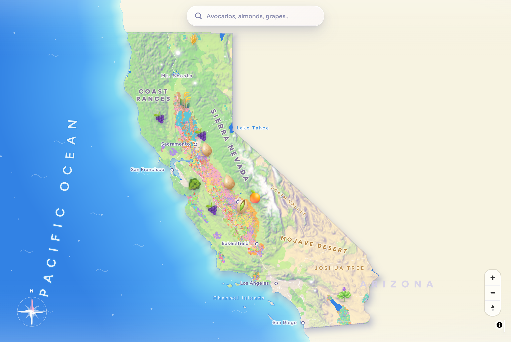

# What's growing here?

A playful map of what California grows, from field-level crop data.

**Live: [crops.sabhyachhabria.com](https://crops.sabhyachhabria.com)**



Every farm field in the state, coloured by crop, on a hand-tuned pastel basemap. Emoji markers bob over the
regions famous for each crop, the "What's in view" legend tallies the fields on screen, clicking a field opens a
card with its crop, acreage and county, and search lights up where a crop grows statewide
(try "almonds"). Demo videos: [laptop](docs/demo/demo-laptop.mp4), [mobile](docs/demo/demo-mobile.mp4).

## How it works

A static site with no backend: Vite + TypeScript + [MapLibre GL](https://maplibre.org/) v5, with every map layer
read straight from [PMTiles](https://protomaps.com/docs/pmtiles) archives over HTTP range requests.

| Path | What |
|---|---|
| `site/` | The web app (`npm run dev`, `npm run build` → `site/dist/`) |
| `site/public/data/` | Small runtime data (crop list, regions, rasters, labels); the `.pmtiles` are built, not committed |
| `pipeline/` | Python + GDAL/tippecanoe pipeline that turns the DWR shapefile into tiles and regions |
| `data/lookup/` | Hand-curated crop lookup (DWR code → name, emoji, colour, harvest months) and place names |
| `assets-src/` | Icon sources |
| `docs/` | Notes on crop codes, regions, icons, fonts, harvest sources, and screenshots |

## Run it locally

The app expects four PMTiles archives in `site/public/data/`: `basemap.pmtiles`, `fields.pmtiles`,
`overview.pmtiles` and `fields-low.pmtiles`. Build them with the pipeline below, then:

```bash
cd site
npm install
npm run dev        # http://localhost:5173
```

### Build the data

Needs [uv](https://docs.astral.sh/uv/), GDAL (`ogr2ogr`), [tippecanoe](https://github.com/felt/tippecanoe) and the
[pmtiles CLI](https://github.com/protomaps/go-pmtiles) (`brew install gdal tippecanoe pmtiles` on macOS).

```bash
make setup         # Python deps + checks the CLI tools
make download      # DWR Statewide Crop Mapping 2023 shapefile (~172 MB)
make all           # fields, overview, low-zoom fields, regions -> site/public/data/
pipeline/basemap.sh   # California extract of the latest Protomaps daily build (~640 MB at z14)
```

## Deploy

`npm run build` deliberately leaves the `.pmtiles` out of `dist/`: they are too big for most static hosts, so host
them anywhere that serves HTTP range requests with CORS (Cloudflare R2, S3, a plain nginx/Caddy box) and point the
build at them:

```bash
VITE_BASEMAP_URL=https://tiles.example.com/basemap.pmtiles \
VITE_FIELDS_URL=https://tiles.example.com/fields.pmtiles \
VITE_OVERVIEW_URL=https://tiles.example.com/overview.pmtiles \
VITE_FIELDS_LOW_URL=https://tiles.example.com/fields-low.pmtiles \
npm run build
```

The live site runs on Cloudflare Pages with the tiles on R2. `.github/workflows/deploy.yml` builds every push:
`main` deploys to production and other branches to `<branch>.<project>.pages.dev` previews. It reads the repo
variables `TILES_BASE` and `PAGES_PROJECT` and the secrets `CLOUDFLARE_API_TOKEN` (Cloudflare Pages: Edit) and
`CLOUDFLARE_ACCOUNT_ID`; forks without them skip the deploy. `deploy.sh` does the same from a terminal,
`r2-cors.json` is the bucket's CORS policy, and `site/public/_headers` sets the Pages cache headers.

## Data and credits

- **Crop fields:** California Department of Water Resources, [Statewide Crop Mapping 2023](https://data.cnra.ca.gov/dataset/6c3d65e3-35bb-49e1-a51e-49d5a2cf09a9),
  produced by Land IQ.
- **Basemap:** © [OpenStreetMap](https://www.openstreetmap.org/copyright) contributors (ODbL), via
  [Protomaps](https://protomaps.com).
- **Terrain shading:** [AWS Terrain Tiles](https://registry.opendata.aws/terrain-tiles/) (Terrarium).
- **Crop icons:** [Microsoft Fluent Emoji](https://github.com/microsoft/fluentui-emoji) (MIT), plus original SVGs for
  crops without an emoji ([docs/icons.md](docs/icons.md)).
- **Font:** [Figtree](https://github.com/erikdkennedy/figtree) (SIL OFL 1.1, `site/public/webfonts/OFL.txt`).

## License

Code and original artwork: [MIT](LICENSE). Third-party data, icons and fonts keep their own licenses, listed above.
